# Hand-worked tracer cases (ANV-6)

Seventeen small boards, each with the answer worked out by hand before any
tracer test used it (decision D13). They cover every rule the tracer follows for
MS2: the board edge, walls, all four mirror orientations from every straight
direction, edge-on and square-on mirrors, targets of the right and wrong color,
beams passing through targets and mixing, two sources, a splitter, a loop and a
diagonal beam. The rules themselves are D21 and D22 in
[docs/DECISIONS.md](../DECISIONS.md).

- **Who worked them out:** Anvi, by hand. An AI agent then worked the same
  answers independently, by reasoning rather than by running code (D23), and
  the two sets matched.
- **Independent check:** Victor works boards 5 and 9 on his own from the blank
  versions in [victor-check.md](victor-check.md), before reading their answers
  here.
- **Pictures:** drawn by [draw_boards.py](draw_boards.py) from the answers
  below, not by the tracer. Run `python3 docs/tracer-cases/draw_boards.py` from
  the repository root to redraw them.
- **Tests:** these boards become tests in `test/test_tracer.ml`.

## How to read a board

Row 0 is the top and column 0 the left; N is up. One character per cell:

| Character | Meaning |
|---|---|
| `.` | empty |
| `#` | wall |
| `/` `\` `-` `\|` | mirror lying along that line |
| `s` | splitter (the legend gives its line) |
| `A`, `B` | source (the legend gives its direction and color) |
| `1`, `2` | target (the legend gives its color) |

Each answer gives:

1. **Path:** every cell of each beam in order, as (row, col), with the direction
   it travels. Where a mirror or splitter turns it, the cell shows the way in
   and the way out, e.g. `E→N`.
2. **Stops:** where and why the beam ends (board edge, wall, mirror edge, loop).
3. **Targets:** the color reaching each target, which is the mix of every beam
   through it.
4. **All lit:** whether every target is lit. A board with no targets counts as
   lit.

---

## Board 1: an empty board

Tests: a beam leaving the board, and the path starting in the source's own cell.

```
      0 1 2 3 4
  0   . . . . .
  1   . . . . .
  2   . A . . .
  3   . . . . .
```
A: source facing E, red.


- **Path:** (2,1) E, (2,2) E, (2,3) E, (2,4) E; red.
- **Stops:** at the board edge, from (2,4).
- **Targets:** none. **All lit:** yes.

## Board 2: a wall

Tests: a wall stops the beam, and the wall's cell is the last cell of the path.

```
      0 1 2 3 4
  0   . . . . .
  1   A . . # .
  2   . . . . .
```
A: source facing E, green.


- **Path:** (1,0) E, (1,1) E, (1,2) E, (1,3) E; green.
- **Stops:** at the wall in (1,3). Cell (1,4) gets no light.
- **Targets:** none. **All lit:** yes.

## Boards 3a–3d: a `/` mirror from each straight direction

Tests: the four turns a `/` mirror makes. The same 3×3 board each time, with
the mirror at (1,1); only the source changes.

```
      0 1 2
  0   . . .
  1   . / .
  2   . . .
```

| Board | Source | Path | Stops |
|---|---|---|---|
| 3a | (1,0), facing E, red | (1,0) E, (1,1) E→N, (0,1) N | board edge |
| 3b | (1,2), facing W, green | (1,2) W, (1,1) W→S, (2,1) S | board edge |
| 3c | (0,1), facing S, blue | (0,1) S, (1,1) S→W, (1,0) W | board edge |
| 3d | (2,1), facing N, red | (2,1) N, (1,1) N→E, (1,2) E | board edge |

No targets on any of them, so all lit: yes.

 
 

## Boards 4a–4b: a `\` mirror

Tests: the `\` mirror's turns. The same 3×3 board, with `\` at (1,1).

| Board | Source | Path | Stops |
|---|---|---|---|
| 4a | (1,0), facing E, blue | (1,0) E, (1,1) E→S, (2,1) S | board edge |
| 4b | (0,1), facing S, green | (0,1) S, (1,1) S→E, (1,2) E | board edge |

No targets, so all lit: yes.

 

## Board 5: a mirror edge-on, and a mirror square-on

Tests: a beam running along a mirror's line stops in the mirror's cell; a beam
hitting a mirror at right angles comes straight back, through its own source.
Victor works this board independently.

```
      0 1 2 3 4
  0   . . . . .
  1   A . - . .
  2   . . . . .
  3   . B . | .
  4   . . . . .
```
A: source facing E, red. B: source facing E, green.

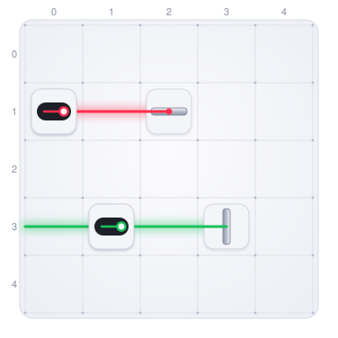

- **Path A:** (1,0) E, (1,1) E, (1,2) E; red.
- **Stops A:** edge-on at the `-` mirror in (1,2). Cell (1,3) gets no light.
- **Path B:** (3,1) E, (3,2) E, (3,3) E→W, (3,2) W, (3,1) W, (3,0) W; green.
  Its own source's cell (3,1) appears twice.
- **Stops B:** at the board edge, from (3,0).
- **Targets:** none. **All lit:** yes.

## Board 6: a target of the right color

Tests: a target lights on its own color, and the beam carries on through it.

```
      0 1 2 3
  0   . . . .
  1   A . 1 .
  2   . . . .
```
A: source facing E, blue. 1: target, blue.


- **Path:** (1,0) E, (1,1) E, (1,2) E, (1,3) E; blue.
- **Stops:** at the board edge, from (1,3).
- **Targets:** 1 gets blue, which equals blue, so it is lit. **All lit:** yes.

## Board 7: a target of the wrong color

Tests: a single beam of another color leaves a target dark.

The same board as 6, except A is **red** and target 1 is **green**.


- **Path:** (1,0) E, (1,1) E, (1,2) E, (1,3) E; red.
- **Stops:** at the board edge, from (1,3).
- **Targets:** 1 gets red, which is not green, so it is dark. **All lit:** no.

## Board 8: through one target to a second

Tests: a target does not stop a beam, so a second target behind it is lit too.

```
      0 1 2 3 4
  0   . . . . .
  1   A . 1 . 2
  2   . . . . .
```
A: source facing E, green. 1 and 2: targets, green.

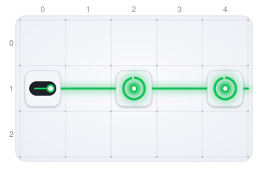

- **Path:** (1,0) E, (1,1) E, (1,2) E, (1,3) E, (1,4) E; green.
- **Stops:** at the board edge, from (1,4).
- **Targets:** 1 gets green, lit; 2 gets green, lit. **All lit:** yes.

## Board 9: two beams mixing in a target

Tests: the color reaching a target is the mix of every beam through it. Neither
beam alone would light this target. Victor works this board independently.

```
      0 1 2 3
  0   . . A .
  1   . . . .
  2   B . 1 .
  3   . . . .
```
A: source facing S, red. B: source facing E, green. 1: target, yellow.

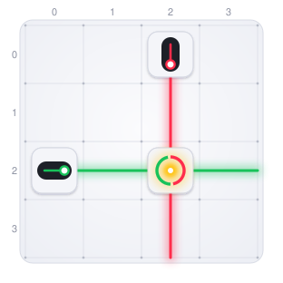

- **Path A:** (0,2) S, (1,2) S, (2,2) S, (3,2) S; red. **Stops:** board edge.
- **Path B:** (2,0) E, (2,1) E, (2,2) E, (2,3) E; green. **Stops:** board edge.
- **Targets:** 1 gets red and green, which mix to yellow, its own color, so it is
  lit. **All lit:** yes.

## Board 10: two sources

Tests: one source's beam passes through another source's cell, and each beam is
traced on its own.

```
      0 1 2 3
  0   . . . .
  1   . . . .
  2   B . A .
  3   . . 1 .
```
A: source facing S, red. B: source facing E, green. 1: target, red.

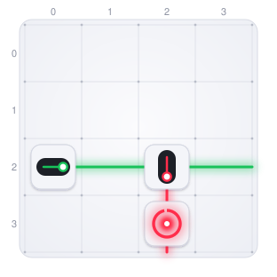

- **Path A:** (2,2) S, (3,2) S; red. **Stops:** board edge, from (3,2).
- **Path B:** (2,0) E, (2,1) E, (2,2) E, (2,3) E; green. It passes through A's
  cell. **Stops:** board edge, from (2,3).
- **Targets:** 1 gets red only, so it is lit. **All lit:** yes.

## Board 11: a splitter

Tests: a splitter sends one beam straight on and turns a second the way a
mirror on the same line would; both keep the color.

```
      0 1 2 3 4
  0   . . . . .
  1   A . s . .
  2   . . . . .
```
A: source facing E, red. s: splitter lying along `/`.

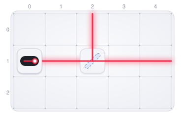

- **Before the split:** (1,0) E, (1,1) E, (1,2) E; red.
- **Straight branch:** (1,3) E, (1,4) E. **Stops:** board edge.
- **Turned branch:** (0,2) N. **Stops:** board edge.
- **Targets:** none. **All lit:** yes.

## Board 12: a loop

Tests: a beam that would go round forever stops when its next cell is one it
already entered travelling the same way.

```
      0 1 2 3 4
  0   . . . . .
  1   . / A \ .
  2   . . . . .
  3   . \ . / .
  4   . . . . .
```
A: source facing E, blue.

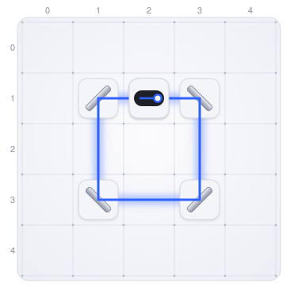

- **Path:** (1,2) E, (1,3) E→S, (2,3) S, (3,3) S→W, (3,2) W, (3,1) W→N,
  (2,1) N, (1,1) N→E; blue.
- **Stops:** loop. Its next cell would be (1,2) heading E, where it started, so
  the path ends in (1,1).
- **Targets:** none. **All lit:** yes.

## Board 13: a diagonal beam

Tests: a diagonal beam, and a `-` mirror turning it.

```
      0 1 2 3 4
  0   A . . . .
  1   . . . . .
  2   . . - . .
  3   . . . . .
```
A: source facing SE, blue.

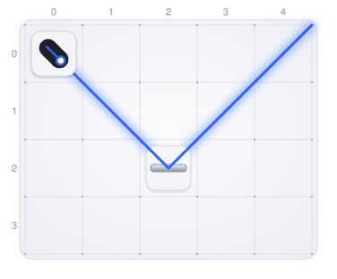

- **Path:** (0,0) SE, (1,1) SE, (2,2) SE→NE, (1,3) NE, (0,4) NE; blue.
- **Stops:** at the board edge, from (0,4).
- **Targets:** none. **All lit:** yes.
