# Independent check: boards 5 and 9 (for Victor)

Victor: please work these two boards out by hand **before** opening their
answers in [README.md](README.md). This is the independent check of the
hand-worked tracer answers (ANV-6). Write your answers in a comment on the pull
request, or in the group chat; then compare with README.md and say whether they
match.

The rules are D21 and D22 in [docs/DECISIONS.md](../DECISIONS.md). In short:

- A beam's path starts in its source's cell. A beam passes straight through
  any source's cell.
- Mirrors reflect from both faces. Square-on (at right angles to the mirror's
  line), a beam comes straight back. Edge-on (along the mirror's line), it
  stops in the mirror's cell.
- A beam passes through a target. The color reaching a target is the mix of
  every beam through it, and the target is lit only if that mix equals its
  color exactly.
- A beam that stops (at a wall or a mirror edge) ends in that cell. At the
  board edge, it ends in the last cell on the board.

For each board, give:

1. **Path:** each beam's cells in order, as (row, col), with the direction it
   travels (write a turn as `E→N`).
2. **Stops:** where and why each beam ends.
3. **Targets:** the color reaching each target.
4. **All lit:** yes or no.

Row 0 is the top and column 0 the left; N is up.

## Board 5

```
      0 1 2 3 4
  0   . . . . .
  1   A . - . .
  2   . . . . .
  3   . B . | .
  4   . . . . .
```
A: source facing E, red. B: source facing E, green. `-` and `|` are mirrors.



## Board 9

```
      0 1 2 3
  0   . . A .
  1   . . . .
  2   B . 1 .
  3   . . . .
```
A: source facing S, red. B: source facing E, green. 1: target, yellow.


